# OFFgrid-SDR

**A complete radio receiver in a single file. No installation, no internet, no account: plug in an RTL-SDR stick, open the page, and listen.**

OFFgrid-SDR is a full software-defined radio receiver that runs entirely in your web browser from one file. Put the `index.html` on a USB pen drive with an RTL-SDR stick and an antenna, and you have a working shortwave, FM, airband and VHF/UHF receiver on almost any computer: no software to install, no administrator rights, no drivers to download on site (on most systems), and no requirement for an internet connection.

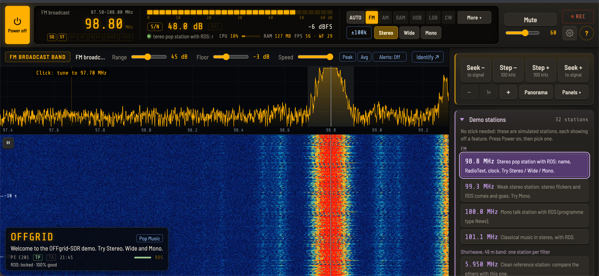

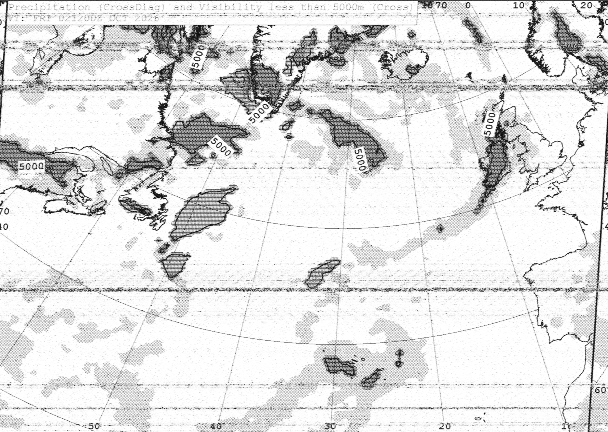

## Demo video (version 1.1)

[](https://youtu.be/TMCA4gI8UnE)

Looks good on a Chromebook in tent mode or tablet mode:

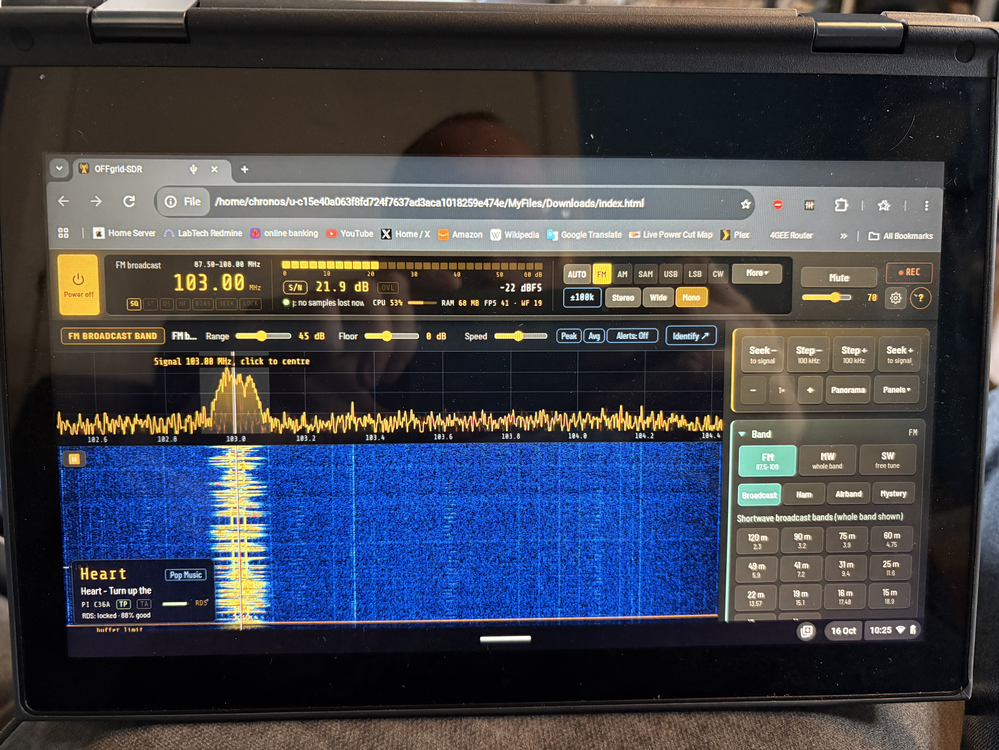

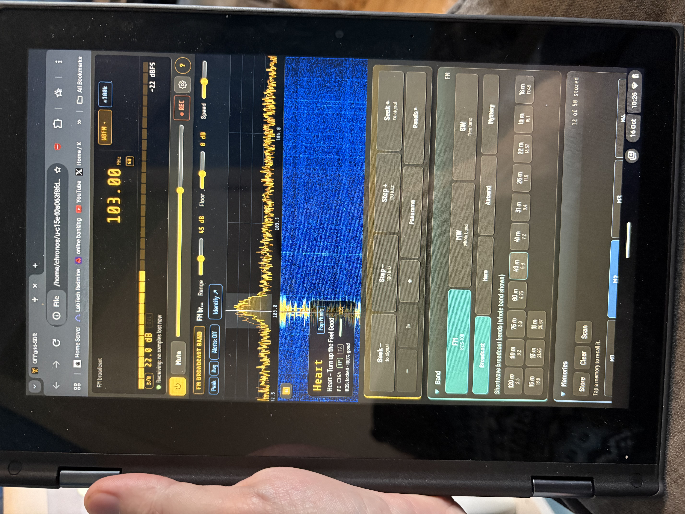

## Why I made this

The humble RTL-SDR stick needs some love. It has always been treated as an add-on: a cheap way into other SDR software, never the star of the show. I decided to change that, and build a receiver made for the RTL-SDR, that anyone can carry on a pen drive and use anywhere.

Ideally, I wanted to see a whole 10 MHz of spectrum in one go, spot a signal, and click on it. From there, the workflow goes:

1. **Click a signal** in the 10 MHz overview. The view switches to a 2.04 MHz wide bandwidth with a waterfall.
2. **Zoom in, or pause** and highlight a signal in the waterfall. A zoomed-in replay section appears.
3. **Use the A/B buttons** to narrow the selection in more detail.
4. **Save the signal** for later analysis.

**10 MHz view → 2.04 MHz view → signals tens of Hz wide → analyse or save**

---

## What's new in 1.9

**New modes**

- **APRS:** radio amateurs' positions, weather stations, messages and status reports on VHF, decoded from their 1200-baud data bursts. Each station is listed with its distance and bearing, speed and heading, height for balloons, and weather in °C, km/h and hPa. Choosing APRS goes to the frequency for where you are (144.800 MHz in Europe, 144.390 in North America, 145.175 in Australia, and the others in a list, including the International Space Station's).
- **AIS:** ships' automatic identification, decoded on **both marine channels at once** (161.975 and 162.025 MHz). Each vessel appears once, updated as it's heard: name, type, distance and bearing, speed and course, at anchor or moored, and where it's bound. Hover for its MMSI, flag, call sign, size, draught and ETA. Coast stations and buoys too.

Both show only error-free messages, checked with their CRC.

<!-- New screenshots: add these files to the screenshots folder, then remove the comment marks around these lines.


-->

**Setup and the clock**

- **A first-time setup**, offered the first time you choose FT8, FT4, WSPR or Time signal. It sets your location (asking the computer's own location straight away, with 620 built-in cities as well), finds a shortwave time station whose carrier **calibrates your stick** and whose time code **sets the clock**, and shows the results. Skip it at any point; run it again from *Settings → Calibration → Run setup again*. Other modes never ask.
- **Clock details:** how far your computer's clock is from the time stations, how fast it drifts, the correction in use, and how to set the computer's own clock.
- **A smarter clock:** two time-signal readings a day or more apart teach OFFgrid-SDR how fast your computer's clock drifts, and it follows that between checks, warning when the last check is getting old.
- **WSPR now decodes with the clock a minute or so out,** then puts the clock right to within a tenth of a second, which FT8 alone can't do beyond 7.5 seconds. A computer that's been away from the internet for weeks comes right just by listening to WSPR.
- **Find a time station** is quicker: it skips empty frequencies, tries the stations that give the time fastest first, and copes better with a stick that's well off frequency.

<!--  -->

**Hardware**

- **HF upconverters** such as the Nooelec [Ham It Up](https://www.nooelec.com/store/ham-it-up.html): *Settings → Device → HF upconverter*. **Auto** uses the converter below 65 MHz (MW, shortwave, HF) and tunes straight through above (FM, airband, VHF), reminding you which way to set its switch; **On** uses it always; **Off** is the default. Every frequency shown stays the real one. The oscillator is 125 MHz by default (100 MHz on older Ham It Ups, 120 MHz on a SpyVerter), with fine tuning in Hz.
- **Each stick keeps its own frequency correction:** plug a calibrated stick in again and its correction comes back; a different stick starts at 0 ppm.
- **The FM band for your country,** chosen from your location: 87.5–108 MHz for most of the world, 87.9–107.9 MHz in 200 kHz steps in the USA, Canada and Mexico, 76–95 MHz in Japan, 76–108 MHz in Brazil and Chile, and 65.8–108 MHz in Russia and some neighbouring countries.

**Fixes**

- AUTO no longer mistakes a broadcast station deep in a fade for Hellschreiber.
- The clock correction remembers where it came from after a restart.
- Memories are safe while a settings backup is being imported.
- Demo mode: no longer switches the radio off going from VHF back to shortwave, can't freeze a busy computer, has no breaks in its VHF background noise, and runs its 40 and 41 m bands more than twice as fast. New demo stations: APRS on 144.800 MHz and ships in Liverpool Bay on the AIS channels.

### Previously, in 1.8

- **WSPR** weak-signal beacons, and **Time signal**, which sets OFFgrid-SDR's clock from CHU, WWV, WWVH and RWM with no internet.
- **FT8 and FT4:** deeper decoding (weaker stations hidden under strong ones, marked ◆), band lists, and room for uncalibrated sticks.
- **Heard** (who can you hear, band by band) and **Band survey** (which bands are open, in about 5 minutes).
- The radio library updated to Jacobo Tarrío's webrtlsdr 3.0.7 and signals 0.10.2, fixing weak reception and drift after a restart.

### Previously, in 1.7

- **A much smarter AUTO:** finds and tunes SSB voices to within a few hertz, recognises more modes (FT8, FT4, ACARS, PSK63 and PSK125, DRM), and makes fewer wrong guesses.
- **New and better decoders:** FT4; country, distance and bearing for every FT8 and FT4 station, with 620 built-in cities for setting your location offline; PSK that starts part-way through a transmission; and RTTY that sorts out mark and space by itself.
- **Keyboard shortcuts**, memory markers on the spectrum, a UTC clock, and the power-on lamp test.
- **More reliable** switching off and on, decoders that recover from broken audio, and **Check for updates**.

### Previously, in 1.6

- **A cleaner, simpler layout:** a top bar that is always in view, one-click mode buttons, a Settings dialog with tabs, status lights under the frequency, a pinned Seek / Step box with a Panels menu, and a tall (portrait) view for Chromebooks and tablets.
- **More reliable:** fast band switching fixed, USB stick recovery after an unplug or reset, and a diagnostics log.
- **Better gain control:** the **OVL** overload indicator with one-click gain back-off and Undo, and RF gain remembered per band.
- **New decoders:** FT8, ACARS, PSK (PSK31, PSK63 and PSK125), and weather fax from any band.

### Previously, in 1.5

- **AI voice cleaner** (RNNoise, offline), **Smart notch**, the **Logbook**, **frequency labels**, **new-signal alerts**, peak hold and averaging, the **signal info popup**, better **replay**, **Low-power mode**, AGC speed for SSB and CW, SSTV in LSB, and 25 kHz airband channel names.

1.4 added waterfall replay, AUTO, six decoders (RTTY, NAVTEX, DSC, SSTV, PSK31, Hellschreiber), frequency calibration and the ten-button mode layout.

---

## Built for places without internet

Most SDR software assumes you can download it, install it, and often fetch maps or updates online. OFFgrid-SDR assumes none of that. It was designed for situations like these:

- **Remote stations and expeditions.** A research station in Antarctica, a ship at sea or a remote field camp: send out a stick, an antenna and a pen drive, and the people there can listen to shortwave news, weather fax charts, NAVTEX safety messages and more, with no internet at all.
- **Emergency and resilience kits.** When the internet or the power grid is down, radio still works. The whole receiver fits on a pen drive in a grab bag.
- **Remote signal monitoring.** Leave it running for hours, record what it hears, and save weather fax charts automatically, all offline.
- **Locked-down or shared computers.** Schools, libraries, work laptops and Chromebooks often block installing software. OFFgrid-SDR is just a page you open.
- **Privacy.** Nothing leaves your computer. The page makes no network requests of its own; your settings and memories stay in your browser. The only exceptions are two optional buttons, which contact the internet only when you click them: the **Identify** menu, which looks up the tuned frequency online, and **Check for updates** in the help panel, which looks on GitHub for a newer version. If you allow it, the browser's own location service may be used to set your location (the setup asks); OFFgrid-SDR itself sends nothing.
- **Works fully offline, FT8 included.** FT8, FT4 and WSPR normally need an accurate internet clock; OFFgrid-SDR sets its clock from time stations and corrects it from the stations it hears. Station countries come from a table built into the app, and your location from 620 built-in cities.
- **Demo mode** for training in ham radio classes, radio clubs and meetups: great for teaching the up-and-coming generation interested in radio.

---

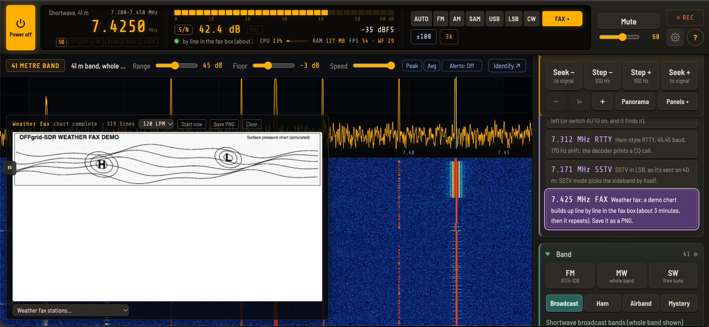

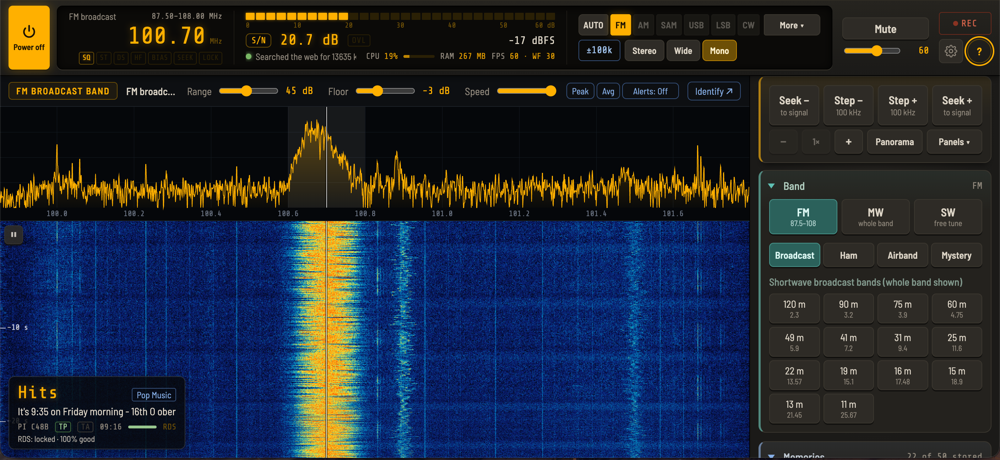

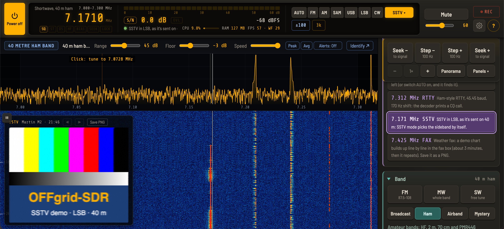

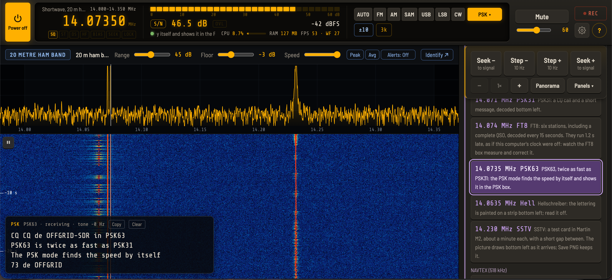

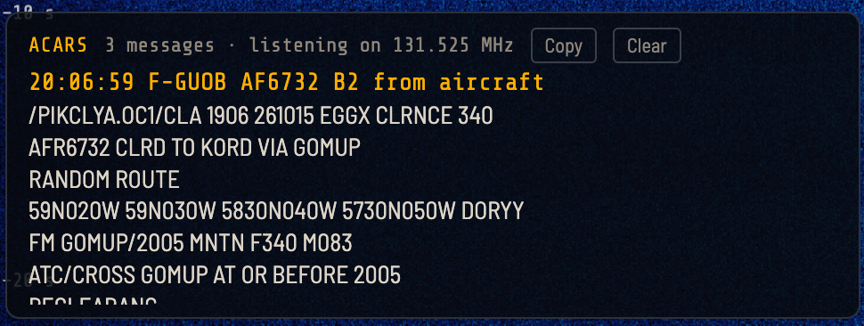

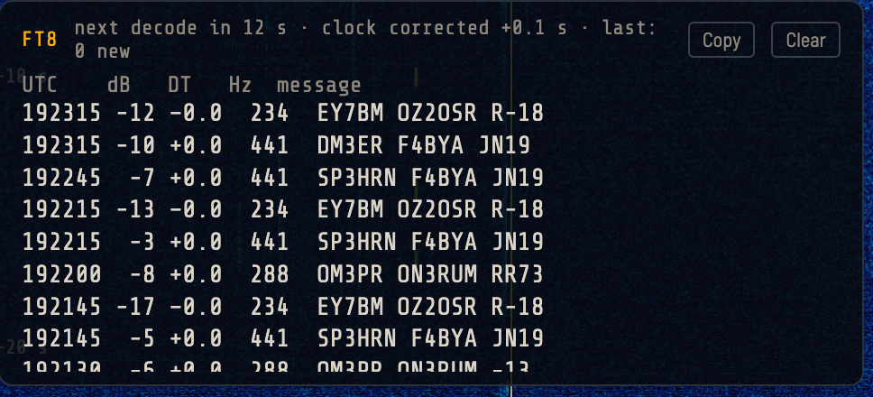


## What you need

| | |
|---|---|
| **An RTL-SDR stick** | Tested with the **RTL-SDR Blog V4** (recommended: shortwave works with no adapter, and it has a 4.5 V bias-tee), the RTL-SDR Blog V3, and the **Nooelec NESDR SMArt v5**. Other RTL2832U sticks with an **R820T, R820T2 or R828D** tuner should work too. Older sticks with an **E4000, FC0012, FC0013 or FC2580** tuner won't work (OFFgrid-SDR says so if you plug one in). |
| **An antenna** | The telescopic antenna that comes with most sticks is fine for FM. For medium wave and shortwave, tested with the **AURSINC GA800** active loop and the **YouLoop** passive magnetic loop (which folds up small for travel). For APRS and AIS, a VHF antenna mounted high; AIS works best near the coast or a big river. |
| **An HF upconverter** (optional) | Not needed with the V4. For sticks without HF, a converter such as the Ham It Up: set *Settings → Device → HF upconverter* to **Auto** or **On**. |
| **A browser with WebUSB** | Google Chrome, Microsoft Edge, or another Chromium-based browser (Opera, Vivaldi, Chromium). Tested on Windows 11, macOS Tahoe and ChromeOS, including a budget **Lenovo 300e** Chromebook in laptop and tablet mode, landscape and portrait. Firefox and Safari don't support WebUSB. |

### Sending a kit somewhere without internet

Pack the stick, an antenna, the cables, and a USB pen drive containing:

- `index.html` (the whole receiver), plus `README.txt`, the offline guide, so the people there can look things up without internet;
- a settings backup with memories and frequency labels for the stations you expect (made with *Settings → Backup → Export settings*);
- [Zadig](https://zadig.akeo.ie) for any Windows computer, since there'll be no way to download it on site;
- a browser installer, in case the computer there doesn't have a suitable one (Windows 10/11 already has Edge).

Before sending it, run the **setup** (*Settings → Calibration → Run setup again*): it sets the location, calibrates the stick and sets the clock. All are saved in the settings backup, so the kit arrives ready.

---

## Quick start

OFFgrid-SDR is **one file**: `index.html`. That's all you need; everything else in this repository is documentation and licences.

1. **Download `index.html`:** click it in the file list above, then click the **Download raw file** button (the download arrow at the top right of the file view). Save it anywhere, a USB pen drive included. (To get everything, the README and licences too, use **Code → Download ZIP** at the top of this page.)
2. Open `index.html` in Chrome or Edge.
3. Plug in the stick, press **Power on**, and choose the stick in the browser's USB chooser.

**Keeping up to date:** open the help panel (**?**) and press **Check for updates**. It tells you if there's a newer version, with a link to this page. To update, download the new `index.html` and put it in place of the old one: your settings and memories are kept when the new file goes in the same place (for safety, export a backup first).

**No stick yet?** Open `index.html?demo` for **demo mode**: simulated stations that show off every feature, including FM stereo with RDS, fading shortwave, SSB, Morse, a weather fax chart, RTTY and NAVTEX bulletins, a DSC distress call, SSTV test cards, PSK31 and PSK63, FT8, FT4 and WSPR, the time stations CHU, WWV and RWM, ACARS, APRS, ships on AIS, Hellschreiber, a DRM broadcast, a whistle-and-hum station for the smart notch, and the famous "Buzzer". Press Power on, then pick a station from the Demo stations list.

**Testing a release:** with `selftest.js` beside `index.html`, opening `index.html?demo&selftest` runs a self-test of 64 checks across every mode and decoder, in about 15 minutes. Nothing it does is saved.

### One-time driver setup

- **Windows:** run [Zadig](https://zadig.akeo.ie), choose *Options → List All Devices*, select *Bulk-In, Interface (Interface 0)* (or *RTL2838UHIDIR*), choose **WinUSB** and click **Replace Driver**.
- **macOS:** no configuration needed.
- **Chromebooks:** no configuration needed.
- **Linux:** stop the TV driver from claiming the stick, and give your user access to it:
  ```sh
  echo 'blacklist dvb_usb_rtl28xxu' | sudo tee /etc/modprobe.d/rtl-sdr-blacklist.conf
  sudo modprobe -r rtl2832_sdr dvb_usb_rtl28xxu        # or reboot
  echo 'SUBSYSTEM=="usb", ATTRS{idVendor}=="0bda", ATTRS{idProduct}=="2838", MODE="0666"' | sudo tee /etc/udev/rules.d/20-rtlsdr.rules
  sudo udevadm control --reload-rules && sudo udevadm trigger
  ```
  Then unplug the stick and plug it back in. With Snap Chromium on Ubuntu, also run `sudo snap connect chromium:raw-usb`.

Only one program can use the stick at a time, so close SDR#, SDR++, gqrx or rtl_tcp first.

---

## What it can do

### Layout

- **Top bar** that is always in view: frequency, S-meter, mode, volume, mute, record, settings (gear icon), keyboard shortcuts and help, on desktop and on phones. Status lights and a **UTC clock** sit under the frequency digits (click the clock for local time).
- **Seek / Step box** pinned at the top of the side panel, with a **Panels** menu to jump straight to Band, Memories, Audio & gain and the rest.
- **Settings dialog** (gear icon) with tabs for Device, Display & tuning, Audio & recording, Decoders, Calibration and Backup.
- **Tall (portrait) view** for Chromebooks and tablets held upright.
- **Power-on lamp test:** pressing Power lights every light in the top bar for 2 seconds while the meter sweeps up and back, like a car's dashboard.

### Keyboard shortcuts

| Key | Action |
|---|---|
| **← →** | Step down / up (Shift: seek to the next signal) |
| **↑ ↓** | Volume up / down (Shift: in small steps) |
| **PgUp / PgDn** | Next / previous band in the list you're in |
| **0–9** | Type a frequency, from anywhere (the number pad too); Enter to go |
| **A** | AUTO |
| **Space** | Pause / resume the waterfall |
| **Z** | Zero-beat (CW, PSK, Hell) |
| **M / R** | Mute / record |
| **+ −** | Zoom in / out |
| **K / ?** | Keyboard shortcuts / help |
| **Esc** | Close a menu or panel |

When a slider, list or menu is selected, the arrow keys work on it instead.

### Bands

- **FM broadcast:** stereo, with RDS station names, RadioText and clock. The band follows your country (87.5–108 MHz in most of the world).
- **Medium wave** and **shortwave**, with one-click buttons for every international broadcast band (120 m to 11 m). Each opens the whole band on the waterfall.
- **Amateur bands:** 160 m to 10 m, **2 m** and **70 cm**.
- **PMR446:** all 16 licence-free walkie-talkie channels, stepping channel by channel.
- **Airband** (118–137 MHz) in 2 MHz sections, with **8.33 kHz channel steps** and channel names (type 118.505 and you're on the right channel). Type a 25 kHz-style name, such as 120.625, and those channels keep the familiar names you'd see on a chart.
- **Mystery:** famous unexplained HF stations, including **The Buzzer (UVB-76)**, The Pip, The Squeaky Wheel and other Russian military "channel markers".
- **Any other frequency** from 100 kHz to 1766 MHz: type it in (for example `198k`, `162.025`, `1090M`) and it opens in general coverage mode.
- Each band opens in its own mode and remembers your last frequency, tuning step and **RF gain**. Changing band zooms back out to the full view.

### Modes

The same eight buttons on every band:

**AUTO · FM · AM · SAM · USB · LSB · CW · More ▾**

- **FM** is wideband on the FM broadcast band (stereo, RDS) and narrowband everywhere else (repeaters, PMR446, marine).
- **SAM** is synchronous AM, which stops fading distortion. **SAM-U and SAM-L** (under More) use just one sideband, to dodge a neighbouring station splattering into the other side: a feature usually found only on specialist receivers.
- **More ▾** holds SAM-U and SAM-L, the decoders (RTTY, PSK, NAVTEX, DSC, FT8, FT4, WSPR, time signal, ACARS, APRS, AIS, weather fax, SSTV, Hellschreiber) and explicit Wide or Narrow FM.
- Modes that don't fit where you're tuned are **greyed out**, with the reason in the tooltip, so the row never changes shape.

### AUTO

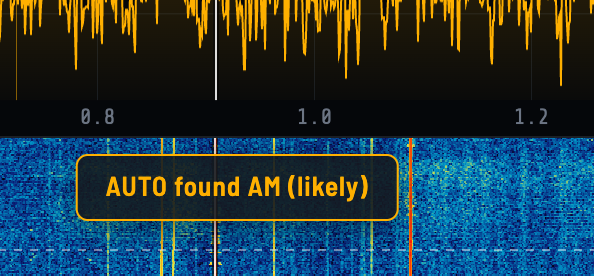

Switch **AUTO** on, and every time you tune somewhere new OFFgrid-SDR listens for a couple of seconds, works out what the signal is, switches to the right mode and tunes onto it. A banner at the top of the waterfall shows it listening, then what it found and how sure it is.

| Where | What AUTO recognises |
|---|---|
| **Shortwave** | CW, RTTY, PSK31, PSK63 and PSK125, NAVTEX, DSC, weather fax, SSTV, Hellschreiber (in the amateur bands), AM (fading or not) and SSB, judging USB or LSB from the voice itself |
| **FT8, FT4 and WSPR frequencies, time stations** | FT8, FT4, WSPR and Time signal |
| **VHF / UHF** | Narrowband FM and airband AM, **ACARS** on its airband channels, **APRS** on its frequencies and **AIS** on the marine AIS channels |
| **FM broadcast band** | Wideband FM |
| **Anywhere on HF** | **DRM** digital broadcasts, which it tells you about (they can't be decoded in a browser) |

On an SSB voice, AUTO finds the whole voice wherever the dial sits on it, then tunes to the suppressed carrier to within a few hertz by lining up the harmonics of the speaker's voice. If nothing is clear, it picks the band's usual mode. Choose a mode yourself, or press AUTO again, to switch it off.

### Decoders

- **RDS** on FM: station name, programme type, RadioText and clock, with a status line (*searching*, *no data*, or *locked · 98% good*).
- **Morse (CW):** learns the sending speed by itself (4 to 60 words per minute) and ignores voice and noise. Click near a Morse signal to tune exactly onto it, or press **Z** to zero-beat.
- **RTTY:** radioteletype from weather and news stations and radio amateurs. Finds the shift (170, 425, 450 or 850 Hz), the speed (45.45, 50 or 75 baud), and which way round mark and space are, by itself.
- **NAVTEX:** maritime safety and weather messages on 518 kHz, 490 kHz and 4209.5 kHz, with each message's station, subject and number. Damaged characters are repaired from their second copy.
- **DSC (Digital Selective Calling):** ships' distress, urgency, safety and routine calls on the HF DSC frequencies, listed with who called whom (MMSI numbers). Distress calls are shown in red.
- **FT8 and FT4:** decode everyone in the passband (6 kHz wide, from 1.5 kHz below the dial) every 15 seconds (FT8) or 7.5 seconds (FT4), and list them with the time, strength, timing, audio frequency and message.
  - Each decode shows the station's **country** (from its callsign, using a table of 269 countries built into the app) and, with your location set, its **distance** in km and miles and its bearing.
  - **Expand**, **CQ only**, sorting by time, distance, strength or country, and **Copy**. CQ calls are shown in yellow, and calls to your own callsign are highlighted.
  - **Deeper decoding** takes the stations it has found out of the signal and decodes again, so weaker stations hidden under strong ones come through, marked ◆.
  - A **band list** goes straight to the FT8 or FT4 frequency on any band.
- **WSPR:** weak-signal beacons, decoded every 2 minutes down to about −28 dB, with each station's transmitter power. It finds the stations even with the clock a minute or so out, then corrects the clock; and if the stations land away from where they should, it offers to correct the stick.
- **Time signal:** sets OFFgrid-SDR's clock from CHU (3.330, 7.850, 14.670 MHz), WWV and WWVH (2.5 to 25 MHz) or RWM (4.996, 9.996, 14.996 MHz). **Find a time station** tries them all; **Set by hand** takes the time from a phone if none can be heard; **Clock details** shows how far out the computer's clock is, and how fast it drifts.
- **Heard and band survey:** **Heard** sums up who you can hear, band by band (stations, countries, the farthest, the directions each band is open towards, rising or fading), and **Survey bands** checks every band from 80 to 10 m in about 5 minutes.
- **APRS:** radio amateurs' positions, weather stations, messages and status on VHF, with distance, bearing, speed, heading and weather in metric units. Hover for the exact position and the digipeaters a packet came through.
- **AIS:** ships on both marine AIS channels at once, one row per vessel, updated as it's heard, with name, type, distance, bearing, speed, course, status and destination. Hover for its MMSI, flag, call sign, size and ETA.
- **ACARS:** aircraft text messages on the airband. Choosing ACARS away from an ACARS channel tunes to 131.550 MHz.
- **SSTV (slow-scan TV):** pictures in the Martin, Scottie and PD formats, drawn line by line and saved as PNG. On shortwave in USB (14.230 MHz) or LSB on 40 and 80 m, and on VHF (the ISS on 145.800 MHz during its SSTV events).
- **PSK:** keyboard-to-keyboard ham text. Decodes PSK31, PSK63 and PSK125, finds the speed by itself, and starts within a couple of seconds even part-way through a transmission.
- **Hellschreiber:** the tone paints the letters on a scrolling strip and you read them by eye, just like the original 1930s machines.
- **Weather fax:** decodes HF radiofax charts line by line, lines them up automatically, and saves them as full-resolution PNG images, including automatic saving of every chart. A station list covers the German, UK and US weather fax services.

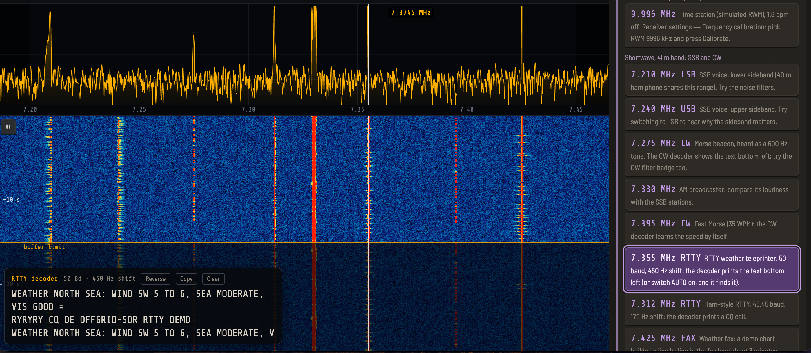

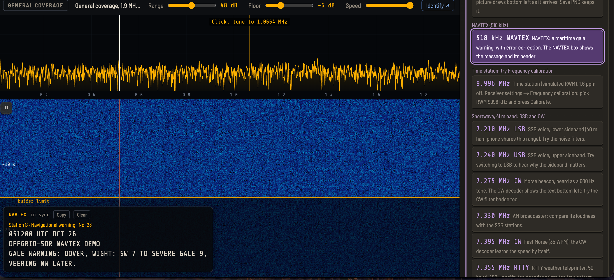

### Waterfall replay

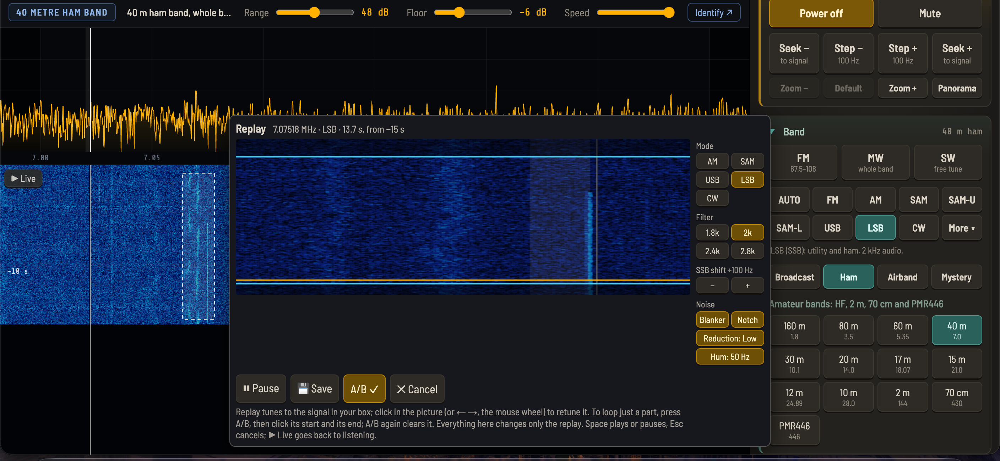

Ever heard something interesting a moment too late? Switch on the **waterfall buffer** (15, 30 or 60 seconds), and OFFgrid-SDR keeps the raw radio signal in memory.

1. Press **⏸** on the waterfall to freeze it.
2. Draw a box around any signal from the last few seconds.
3. A **replay window** opens with a zoomed, detailed view of that moment, and plays it on a loop.

In the replay window you can choose its **own mode, filter, SSB shift and noise filters**; **retune** within the box; **decode Morse** from just that section; loop part of it with **A/B**; **Save** it as an MP3, plus a **raw IQ file** that SDR#, SDR++ and other SDR software open at the right frequency; and hear an FM replay's **RDS**.

While paused, the **mouse wheel** scrolls back through the whole buffer, and **⇕ Whole buffer** squeezes all of it onto the screen. The waterfall keeps running while OFFgrid-SDR is in a background tab, so nothing is missed.

### Listening tools

- **Spectrum and waterfall:** click anywhere to tune, or use the mouse wheel. **Zoom** in up to 256× around the signal.
- **Memory markers:** each memory in view shows as a small tag (M1, M2…) at the foot of the spectrum. Hover for what it is; click it to recall it.
- **Panorama:** sweeps the stick across a wider range than it can see at once, showing **up to 10 MHz at once**: **Around me** (2–10 MHz wide) or the HF slices **0.5–10**, **10–20** and **20–28.8 MHz**. Click a signal to tune to it.
- **OVL overload indicator** beside the S-meter: amber when the band keeps touching full scale, red when the receiver is overloaded. Click it while it's lit and it lowers the RF gain step by step until the overload clears, with **Undo**.
- **RF gain per band:** each band remembers its own RF gain.
- **Noise reduction**, a **noise blanker** for clicks from electric fences and car ignition, a **mains-hum filter** (50 or 60 Hz), and an **auto notch** that removes steady whistles from AM and SSB.
- **AI voice cleaner** (Off, Light, Med, Strong, Full): RNNoise, a small neural network trained on speech, clears hiss, roar and noise-type jamming from voices. Built for speech: the stronger settings quieten music.
- **Smart notch:** **Whine** finds a steady whine and notches it at once. A strip shows the audio: click to drop a notch, drag it until the whine disappears, right-click to remove it.
- **SSB filter widths** of 1.8 to 2.8 kHz and a **passband shift** to dodge a neighbouring station; **AGC speed** (Slow, Medium, Fast) for SSB and CW.
- **Squelch** based on signal-to-noise ratio, **Seek** to the next signal, variable **filter widths**, and an **S-meter**.
- **Scan** your memories: pick any of them, set the squelch, and Scan hops through them, stopping on any with a signal and carrying on 3 seconds after it ends.
- **Peak hold**, **averaging** and **new-signal alerts** on the spectrum.
- **Signal info popup** (optional): hover over a signal for its frequency, level, width, band plan, known frequencies and your own label or memory.
- **Frequency calibration and setup** (*Settings → Calibration*): the setup, or **Calibrate** on a time station, measures the carrier to a fraction of a hertz and sets the stick's correction for you.
- **Identify** (when online): "What's on this frequency?" searches the web for the tuned frequency, "Ask AI" asks Google's AI Mode what's likely there, and "Shortwave radio schedule" (below 30 MHz) shows who is scheduled on that frequency, from [shortwave.live](https://shortwave.live). Nothing is sent until you click.
- **CPU, RAM and FPS** readouts, and **Low-power mode** for older or slower computers (half the samples and half the drawing), which OFFgrid-SDR suggests if the computer struggles.
- Keeps playing, with the waterfall running, when you switch to another browser tab.

### Recording, labels, logbook and settings

- **Record** to MP3 or WAV.
- **50 memories**, each remembering frequency, mode and filters, including the SSB width and shift, and shown as markers on the spectrum.
- **Frequency labels:** right-click the spectrum or waterfall to name a frequency ("Local repeater", "BBC WS"); labels show on the spectrum and under the frequency, and travel in settings backups.
- **Logbook:** date and time (UTC), frequency, mode, signal, station and notes. Stations you stay on for 30 s, and decoder results, are logged by themselves. Edit in place, export as CSV, or keep a CSV file up to date automatically.
- **Settings backup:** export everything to a small file and import it on another computer, ideal for preparing a kit before it's sent out.
- **Diagnostics log:** *Settings → Backup → Save diagnostics log* saves the last three minutes of band changes, retunes, stick errors, the sound output and the signal level, to help track down a problem. It holds no audio, memories or personal data.

### Staying running

- **USB stick recovery:** if the stick is unplugged or resets, the radio goes back to Off cleanly, and if it was on, it starts again by itself when the stick is plugged back in, with clear messages for a lost stick, data stopping and the common USB errors (including the WinUSB driver on Windows).
- **Switching off and on:** the tuner's gain and frequency are re-applied after every start, so the receiver comes back exactly as it was.
- **Fast band switching:** a watchdog restarts the display if it stops, and resends the frequency if the stick and the display disagree.
- **Self-healing decoders:** broken audio samples are filtered out before any decoder hears them, so a decoder can't stop for good.

---

## Known limitations

- **Browser support:** WebUSB is only available in Chromium-based browsers (Chrome, Edge, Opera and so on). Firefox and Safari can run demo mode only.
- **One program at a time** can use the stick.
- **Supported tuners:** sticks with an R820T, R820T2 or R828D tuner (nearly all current sticks). Older E4000, FC0012, FC0013 and FC2580 sticks won't work.
- **Weather fax:** in June 2026 the US National Weather Service proposed closing its five HF radiofax stations towards the end of 2026. They're marked in the station list and will be removed once the closure is confirmed.
- **Morse:** the first letter of a transmission may be missed while the decoder locks on, especially at high speeds.
- **Audio delay:** the sound runs about 0.2 s behind the waterfall. Bluetooth headphones add their own delay on top.
- **Below about 500 kHz** (longwave), reception is weaker than on medium wave and shortwave.
- **Panorama** looks at one slice at a time, so short bursts elsewhere in the range can be missed, and there's no audio while it sweeps.
- **Waterfall replay** uses memory: about 123 MB for 30 seconds at 2.048 MS/s (246 MB for 60 seconds), which is why it's off by default. On computers with 4 GB or less, the longer buffers are greyed out. A selection can't cross a retune.
- **Older and slower computers:** a typical laptop or desktop runs everything smoothly. On a budget or older one, use **Low-power mode**. A very old or very cheap machine may struggle even then.
- **AUTO** judges a couple of seconds of signal, so it can be wrong, especially on very weak signals. If something sounds wrong, choose the mode yourself.
- **FT8 and FT4** still reach a little less deep into the noise than WSJT-X on a single weak station, and on their own can only correct the clock to within their 15-second slots. A clock out by more is put right by a time signal, by WSPR (up to about a minute), or by hand.
- **Time signals:** the UK's MSF (60 kHz) and Germany's DCF77 (77.5 kHz) are below the sticks' range. OFFgrid-SDR corrects its own clock, but a web page can't change the computer's clock itself (**Clock details** shows how to).
- **APRS and AIS** need a VHF antenna and stations within range: APRS is mainly heard near towns and digipeaters, AIS near the coast or a big river.
- **HF upconverters:** the converter's upconvert / passthrough switch is a physical one, so OFFgrid-SDR can only remind you which way to set it.
- **AI voice cleaner:** built for speech, so it quietens or silences music, and it can't separate two voices. It adds about 10 ms of delay.
- **Smart notch:** a long held musical note can look like a whine; right-click its line to remove that notch.
- **DRM** digital broadcasts are recognised but can't be decoded: their audio codecs aren't available in browsers and are tied up in licensing.
- **DSC calls** last only about 6 seconds, so weak or fading ones can be missed. Unreadable digits are shown as ??, never as wrong numbers.
- **Audio extensions** (equalisers and the like) work with OFFgrid-SDR, but if you open it as a file, Chrome needs you to allow each one first: go to `chrome://extensions`, click **Details** on the extension, and turn on **Allow access to file URLs**.
- **Nooelec and other direct-sampling sticks:** on shortwave the signal bypasses the tuner, so the RF gain slider has no effect there (it's greyed out, with an explanation). The RTL-SDR Blog V4 isn't affected.
- **Background tabs:** if the browser's memory saver puts the tab fully to sleep, everything stops, sound included. Tell the browser to keep OFFgrid-SDR active (in Chrome: Settings → Performance → Memory Saver → "Always keep these sites active").

---

 visits and counting!

## Credits and licences

OFFgrid-SDR is built on the work of others:

- [**@jtarrio/webrtlsdr**](https://github.com/jtarrio/webrtlsdr) by Jacobo Tarrío: the WebUSB driver for the RTL2832U and its tuners, including the RTL-SDR Blog V4's HF upconverter. Apache License 2.0. Several of OFFgrid-SDR's fixes to it have since been taken into the original. Version 3.0.7 includes fixes for problems found with OFFgrid-SDR: many thanks to Jacobo for his help.
- [**@jtarrio/signals**](https://github.com/jtarrio/signals) by Jacobo Tarrío: the signal processing, including the FFT, filters, and the FM, AM, SAM (with its selectable sidebands), SSB and CW demodulators. Apache License 2.0.
- **Google Radio Receiver**, the original Chrome app these libraries grew from.
- [**Osmocom rtl-sdr**](https://osmocom.org/projects/rtl-sdr), for working out how to use these USB TV sticks as software-defined radios.
- [**RTL-SDR Blog**](https://www.rtl-sdr.com), for the V4 hardware and their open-source driver work.
- [**ft8_lib**](https://github.com/kgoba/ft8_lib) by Kārlis Goba: the FT8 and FT4 protocol tables, error correction, message formats and decoding method that OFFgrid-SDR's FT8 and FT4 decoders follow. MIT License. FT8 and FT4 themselves were created by **Joe Taylor, K1JT**, and **Steve Franke, K9AN** ([WSJT-X](https://wsjt.sourceforge.io)).
- [**acarsdec**](https://github.com/TLeconte/acarsdec) by Thierry Leconte, whose method of demodulating ACARS (MSK) OFFgrid-SDR's own ACARS decoder follows.
- [**lamejs**](https://github.com/zhuker/lamejs), the JavaScript port of the LAME MP3 encoder. LGPL.
- [**RNNoise**](https://github.com/xiph/rnnoise) by Jean-Marc Valin (Mozilla and the Xiph.Org Foundation), the neural network behind the AI voice cleaner (BSD licence), in the WebAssembly build [**@jitsi/rnnoise-wasm**](https://github.com/jitsi/rnnoise-wasm) by Jitsi (Apache License 2.0).
- [**Barlow Semi Condensed**](https://github.com/jpt/barlow) and [**Share Tech Mono**](https://fonts.google.com/specimen/Share+Tech+Mono) fonts. SIL Open Font License.
- [**esbuild**](https://esbuild.github.io), which bundles everything into a single file that runs offline.
- [**Zadig**](https://zadig.akeo.ie) by Pete Batard, for installing the WinUSB driver on Windows.
- [**Shortwave.Live**](https://shortwave.live), the schedule database the Identify menu's "Shortwave radio schedule" opens.
- Frequencies for the Mystery stations come from [**Priyom**](https://priyom.org).
- Callsign countries follow the **ITU's allocation of callsign prefixes** to countries.
- PSK31 and its Varicode alphabet were created by **Peter Martinez, G3PLX**.
- **WSPR** was created by **Joe Taylor, K1JT**. OFFgrid-SDR's WSPR decoder follows the published protocol, and was checked against the encoder in [**WsprryPi**](https://github.com/JamesP6000/WsprryPi).
- The time-code formats are published by the **National Research Council Canada** (CHU) and **NIST** (WWV and WWVH); the WWV bit layout follows the [**NTP project**](https://www.ntp.org)'s WWV driver.
- Taking decoded FT8 stations out of the signal to find weaker ones follows the method of [**WSJT-X**](https://wsjt.sourceforge.io) by Joe Taylor, K1JT, and its developers.
- **APRS** was created by **Bob Bruninga, WB4APR**. OFFgrid-SDR's APRS decoder follows the published AX.25 and APRS specifications, and the Mic-E format published by **TAPR**.
- **AIS** follows the ITU's published standard (ITU-R M.1371). The decoder was checked against the example messages in Eric S. Raymond's [**AIVDM/AIVDO protocol decoding**](https://gpsd.gitlab.io/gpsd/AIVDM.html) guide for gpsd.

The full licence texts are in the `licenses` folder.

<!-- OFFgrid-SDR's own licence: add a LICENSE file (for example MIT or Apache 2.0) and name it here. -->

---

## Support

OFFgrid-SDR is free. If it's useful to you, you can [**buy me a coffee**](https://buymeacoffee.com/billynomates1974). ☕

73!
