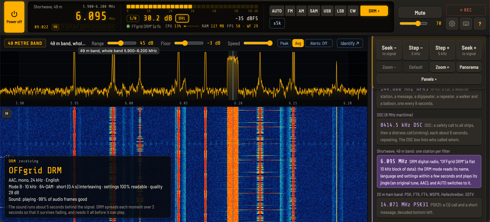

# OFFgrid-SDR

**A complete radio receiver in a single file. No installation, no internet, no account: plug in an RTL-SDR stick, open the page, and listen.**

OFFgrid-SDR is a full software-defined radio receiver that runs entirely in your web browser from one file. Put `index.html` on a USB pen drive with an RTL-SDR stick and an antenna, and you have a working shortwave, FM, airband, VHF/UHF and **DRM digital radio** receiver on almost any computer: no software to install, no administrator rights, no drivers to download on site (on most systems), and no internet connection needed.


## Demo video (version 1.1)

[](https://youtu.be/TMCA4gI8UnE)

Looks good on a Chromebook in tent mode or tablet mode:


## Why I made this

The humble RTL-SDR stick needs some love. It has always been treated as an add-on: a cheap way into other SDR software, never the star of the show. I decided to change that, and build a receiver made for the RTL-SDR, that anyone can carry on a pen drive and use anywhere.

**10 MHz overview → click a signal → 2.04 MHz view with a waterfall → zoom in, or pause and box a signal for a detailed replay → narrow it with A/B → save it for later.**

---

## What's new in 2.0

- **DRM digital radio, with sound.** DRM is digital broadcasting on long, medium and short wave: a flat block about 10 kHz wide on the waterfall, with FM-like sound when it's received well. Tune to its centre and choose **DRM** (under More), or let **AUTO** find it. The DRM box shows the station's **name**, language and audio type, the signal's settings and its **quality**, then plays the **sound** (AAC, including SBR and parametric stereo) about 5 seconds behind the signal, as on any DRM receiver.
  - It finds the robustness mode (A to D) and bandwidth by itself, copes with tuning off centre, mirrored signals and interference on part of the channel, and was tested on real broadcasts in modes A, B and C and off air.
  - When a station can't be played, it **says why**: too weak (16-QAM needs about 10 dB, 64-QAM about 16), or using **xHE-AAC**, unequal protection or hierarchical modulation, which aren't decoded yet. The name and settings are still shown.
  - The **waterfall replay** reads a DRM station's name from a selection, and the **demo** has a real DRM station, "OFFgrid DRM" on 6.095 MHz, playing an original jingle.
- **6 m and 4 m** in the Ham bands, with edges for your country (4 m only where it's allocated).
- **A wider status line** (messages get the whole line, with the CPU and FPS figures beneath), a **CPU figure** that includes the background decoders, and no RAM figure (a web page can only see part of its own memory: Chrome's Task Manager, Shift+Esc, shows the real figure).
- **Fixed:** the waterfall replay of DRM, AIS and APRS sticking on "Preparing…"; RTTY's automatic reverse leaving a station the wrong way round; and noise reduction losing its effect after a brief gap in the audio.
- **OFFgrid-SDR is now free software under the GNU GPL** (see *Credits and licences*).

<!-- New screenshot: add this file to the screenshots folder, then remove the comment marks around this line.

-->

### Earlier versions

- **1.9:** **APRS** and **AIS** (ships on both marine channels at once); a **first-time setup** that sets your location, calibrates the stick and sets the clock from a time station; **Clock details** and a clock that learns your computer's drift; WSPR that corrects a clock a minute out; **HF upconverters** such as the Nooelec [Ham It Up](https://www.nooelec.com/store/ham-it-up.html); each stick keeping its own correction; and the FM band for your country. **1.9.1** fixed the Ham It Up converter's offset not being applied correctly.
- **1.8:** WSPR, **Time signal** (CHU, WWV, WWVH, RWM), deeper FT8/FT4 decoding, **Heard** and **Band survey**.
- **1.7:** a much smarter AUTO, FT4, station countries and distances, keyboard shortcuts, memory markers and **Check for updates**.
- **1.6:** the always-visible top bar and simpler layout, the OVL indicator, and FT8, ACARS, PSK and weather fax.
- **1.5:** the AI voice cleaner, smart notch, logbook, frequency labels and new-signal alerts. **1.4:** waterfall replay, AUTO and the first six decoders.

<!-- New screenshots: add these files to the screenshots folder, then remove the comment marks around these lines.


-->

---

## Built for places without internet

- **Remote stations and expeditions:** an Antarctic base, a ship or a field camp can listen to shortwave news, weather fax, NAVTEX and more, with no internet at all.
- **Emergency and resilience kits:** when the internet or the power grid is down, radio still works, and the whole receiver fits on a pen drive.
- **Remote monitoring:** leave it running for hours, recording, and saving weather fax charts automatically.
- **Locked-down or shared computers:** schools, libraries, work laptops and Chromebooks: it's just a page you open.
- **Privacy:** nothing leaves your computer. The page makes no network requests of its own, except two optional buttons when you click them: **Identify** (looks up the tuned frequency online) and **Check for updates** (looks on GitHub).
- **Fully offline, FT8 included:** the clock is set from time stations and the stations heard; countries come from a built-in table, and your location from 620 built-in cities.
- **Demo mode** for teaching in ham radio classes, clubs and meetups.

## What you need

| | |
|---|---|
| **An RTL-SDR stick** | Tested with the **RTL-SDR Blog V4** (recommended: shortwave with no adapter, and a 4.5 V bias-tee), the Blog V3 and the **Nooelec NESDR SMArt v5**. Other sticks with an **R820T, R820T2 or R828D** tuner should work; older **E4000, FC0012, FC0013 and FC2580** sticks won't. |
| **An antenna** | The telescopic one is fine for FM. For medium wave and shortwave, tested with the **AURSINC GA800** active loop and the **YouLoop**. For APRS and AIS, a VHF antenna mounted high. |
| **An HF upconverter** (optional) | Not needed with the V4. For other sticks, a converter such as the Ham It Up (*Settings → Device → HF upconverter*). |
| **A browser with WebUSB** | Chrome, Edge, or another Chromium-based browser. Tested on Windows 11, macOS Tahoe and ChromeOS (including a budget Lenovo 300e Chromebook). Firefox and Safari can run demo mode only. |

**Sending a kit somewhere without internet:** pack the stick, an antenna and a pen drive with `index.html`, `README.txt` (the offline guide), a settings backup with your memories and labels (*Settings → Backup*), [Zadig](https://zadig.akeo.ie) for Windows, and a browser installer if needed. Run the setup first (*Settings → Calibration → Run setup again*), so the kit arrives with its location, calibration and clock set.

## Quick start

OFFgrid-SDR is **one file**, `index.html`; everything else here is documentation and licences.

1. **Download `index.html`:** click it in the file list above, then **Download raw file**. (For everything, use **Code → Download ZIP**.)
2. Open it in Chrome or Edge.
3. Plug in the stick, press **Power on**, and choose the stick in the browser's USB chooser.

**No stick yet?** Open `index.html?demo` for **demo mode**: simulated stations showing every feature, from FM stereo with RDS, fading shortwave, SSB and Morse to weather fax, RTTY, NAVTEX, DSC, SSTV, PSK, FT8, FT4, WSPR, time stations, ACARS, APRS, AIS ships, Hellschreiber, a DRM station with sound, and "The Buzzer".

**Keeping up to date:** press **Check for updates** in the help panel (**?**). To update, put the new `index.html` in place of the old one: your settings and memories are kept (export a backup first, to be safe).

### One-time driver setup

- **Windows:** run [Zadig](https://zadig.akeo.ie), choose *Options → List All Devices*, select *Bulk-In, Interface (Interface 0)* (or *RTL2838UHIDIR*), choose **WinUSB** and click **Replace Driver**.
- **macOS and Chromebooks:** no configuration needed.
- **Linux:** stop the TV driver from claiming the stick, and give your user access to it:
  ```sh
  echo 'blacklist dvb_usb_rtl28xxu' | sudo tee /etc/modprobe.d/rtl-sdr-blacklist.conf
  sudo modprobe -r rtl2832_sdr dvb_usb_rtl28xxu        # or reboot
  echo 'SUBSYSTEM=="usb", ATTRS{idVendor}=="0bda", ATTRS{idProduct}=="2838", MODE="0666"' | sudo tee /etc/udev/rules.d/20-rtlsdr.rules
  sudo udevadm control --reload-rules && sudo udevadm trigger
  ```
  Then unplug the stick and plug it back in. With Snap Chromium on Ubuntu, also run `sudo snap connect chromium:raw-usb`.

Only one program can use the stick at a time, so close SDR#, SDR++, gqrx or rtl_tcp first.

---

## What it can do

### Bands

- **FM broadcast** in stereo with RDS (the band follows your country); **medium wave**; and **shortwave** with a button for every broadcast band, 120 m to 11 m.
- **Amateur bands:** 160 m to 10 m, **6 m**, **4 m** (where allocated), **2 m** and **70 cm**.
- **PMR446** channel by channel, and **airband** with 8.33 kHz channel steps and channel names.
- **Mystery:** famous unexplained stations such as **The Buzzer (UVB-76)** and The Pip.
- **Any frequency** from 100 kHz to 1766 MHz: type it in (`198k`, `162.025`, `1090M`).
- Each band remembers your last frequency, step and RF gain.

### Modes and AUTO

The same buttons on every band: **AUTO · FM · AM · SAM · USB · LSB · CW · More ▾**. FM is wide on the FM band and narrow elsewhere; **SAM** (synchronous AM) stops fading distortion, and **SAM-U / SAM-L** use one sideband to dodge interference. **More** holds the decoders. Modes that don't fit where you're tuned are greyed out, with the reason in the tooltip.


Switch **AUTO** on, and wherever you tune it listens for a couple of seconds, works out what the signal is, and switches to the right mode, tuned onto it:

| Where | What AUTO recognises |
|---|---|
| **Shortwave** | CW, RTTY, PSK31/63/125, NAVTEX, DSC, weather fax, SSTV, Hellschreiber, AM and SSB (judging USB or LSB from the voice, and tuning to within a few hertz) |
| **FT8, FT4 and WSPR frequencies, time stations** | FT8, FT4, WSPR and Time signal |
| **VHF / UHF** | Narrowband FM, airband AM, **ACARS**, **APRS** and **AIS** on their channels |
| **FM broadcast band** | Wideband FM |
| **Long, medium and short wave** | **DRM**: it switches to DRM, so the name and sound follow (and back to AM if no DRM signal is there after all) |

### Decoders

- **DRM:** digital radio with sound, the station's name, language, settings and signal quality.
- **RDS** on FM: station name, programme type, RadioText and clock.
- **Morse (CW)**, 4 to 60 words per minute, and **RTTY**, finding the shift, speed and mark/space by itself.
- **NAVTEX** maritime safety messages, and **DSC** ships' calls (distress in red).
- **FT8 and FT4** with each station's country, distance and bearing, CQ filtering and sorting, and **deeper decoding** that finds weaker stations hidden under strong ones (◆).
- **WSPR** beacons down to about −28 dB, correcting a clock a minute or so out.
- **Time signal** from CHU, WWV, WWVH or RWM, with **Find a time station**, **Set by hand** and **Clock details**; **Heard** and **Band survey** for who you can hear and which bands are open.
- **APRS** positions, weather and messages, and **AIS** ships on both channels at once, each with distance and bearing.
- **ACARS** aircraft messages, **SSTV** pictures (Martin, Scottie, PD), **PSK31/63/125**, **Hellschreiber**, and **weather fax** charts saved as PNG.

### Screenshots

| | |
|---|---|
|  |  |
|  |  |
|  |  |
|  |  |

### Waterfall replay


Switch on the **waterfall buffer** (15, 30 or 60 seconds), press **⏸**, and draw a box around any signal from the last few seconds: a **replay window** plays it on a loop, zoomed in. Give it its own mode and filters, retune within the box, decode Morse, read RDS or a **DRM** station's name, loop part of it with **A/B**, and **Save** it as MP3 plus a **raw IQ file** for SDR#, SDR++ and other SDR software.

### Listening tools

- **Spectrum and waterfall:** click to tune, zoom up to 256×, memory markers, peak hold, averaging, new-signal alerts and a signal info popup.
- **Panorama:** up to 10 MHz at once, around you or across HF.
- **OVL overload indicator**, with one-click gain back-off and Undo; **RF gain per band**.
- **Noise reduction**, a **noise blanker**, a **mains-hum filter**, an **auto notch**, the **AI voice cleaner** (RNNoise) and the **smart notch** for whines.
- **SSB filter widths and passband shift**, **AGC speed**, **squelch**, **Seek** and **Scan** through your memories.
- **Frequency calibration** from a time station, and **Identify** (when online): a web search, Google's AI Mode, or the [shortwave.live](https://shortwave.live) schedule for the tuned frequency.
- **CPU and FPS** figures, and **Low-power mode** for older or slower computers.
- **Keyboard shortcuts:** ← → step (Shift: seek), ↑ ↓ volume, PgUp/PgDn band, 0–9 type a frequency, A AUTO, Space pause, Z zero-beat, M mute, R record, + − zoom, K shortcuts, ? help.

### Recording, logbook and settings

**Record** to MP3 or WAV; **50 memories**; **frequency labels**; a **logbook** that logs stations and decodes by itself and exports CSV; a **settings backup** for preparing a kit; and a **diagnostics log** to help track down problems. It keeps running in a background tab, recovers by itself if the stick is unplugged or resets, and decoders recover from broken audio.

---

## Known limitations

- **Browsers:** WebUSB is only in Chromium-based browsers (Chrome, Edge, Opera…); Firefox and Safari can run demo mode only. **One program at a time** can use the stick.
- **Tuners:** R820T, R820T2 or R828D sticks only; older E4000, FC0012, FC0013 and FC2580 sticks won't work.
- **DRM** needs a good signal (about 10 dB for 16-QAM, 16 dB for 64-QAM); below that, the settings are read but not the name or sound. **xHE-AAC** stations show their name and settings without sound for now, and the few using unequal protection or hierarchical modulation aren't decoded yet.
- **RTL-SDR Blog V4 near 28.8 MHz:** the stick's own 28.8 MHz clock shows as a strong spike there, so signals nearby (the top of 10 m, and CB around 27 MHz) can be affected. It stays with the antenna disconnected: it comes from the stick, not the band.
- **Waterfall replay** uses memory (about 123 MB for 30 seconds), so it's off by default, and a selection can't cross a retune.
- **AUTO** judges a couple of seconds of signal, so it can be wrong on very weak signals: choose the mode yourself if something sounds wrong.
- **FT8 and FT4** reach slightly less deep than WSJT-X on a single weak station. **Time signals:** MSF and DCF77 are below the sticks' range, and a web page can't set the computer's own clock (**Clock details** shows how).
- **Weather fax:** the US National Weather Service has proposed closing its HF radiofax stations towards the end of 2026; they're marked in the station list.
- **Smaller points:** Morse may miss the first letter while locking on; the sound runs about 0.2 s behind the waterfall (Bluetooth adds more); reception is weaker below about 500 kHz; Panorama looks at one slice at a time; the AI voice cleaner is built for speech; DSC calls last only about 6 seconds; an HF upconverter's switch can only be reminded, not set; on direct-sampling sticks the RF gain has no effect on shortwave.
- **Audio extensions** need *Allow access to file URLs* (in `chrome://extensions`) when OFFgrid-SDR is opened as a file. **Background tabs:** if Chrome's Memory Saver puts the tab to sleep, everything stops: add OFFgrid-SDR to "Always keep these sites active".
- **Slower computers:** use **Low-power mode**; a very old or cheap machine may still struggle.

---

 visits and counting!

## Credits and licences

OFFgrid-SDR is built on the work of others:

- [**@jtarrio/webrtlsdr**](https://github.com/jtarrio/webrtlsdr) by Jacobo Tarrío: the WebUSB driver for the RTL2832U and its tuners, including the RTL-SDR Blog V4's HF upconverter. Apache License 2.0. Several of OFFgrid-SDR's fixes to it have since been taken into the original. Version 3.0.7 includes fixes for problems found with OFFgrid-SDR: many thanks to Jacobo for his help.
- [**@jtarrio/signals**](https://github.com/jtarrio/signals) by Jacobo Tarrío: the signal processing, including the FFT, filters, and the FM, AM, SAM (with its selectable sidebands), SSB and CW demodulators. Apache License 2.0.
- **Google Radio Receiver**, the original Chrome app these libraries grew from.
- [**Osmocom rtl-sdr**](https://osmocom.org/projects/rtl-sdr), for working out how to use these USB TV sticks as software-defined radios.
- [**RTL-SDR Blog**](https://www.rtl-sdr.com), for the V4 hardware and their open-source driver work.
- [**FAAD2**](https://github.com/knik0/faad2) by M. Bakker, Nero AG, Ahead Software AG and contributors: the AAC decoder that plays DRM's sound, built in unmodified with its DRM support. GPL 2 or later. Its exact source and build script are in the `License` folder.
- [**Dream**](https://github.com/Drm-tools/dream), the open-source DRM receiver by Volker Fischer (Technische Universität Darmstadt) and contributors: OFFgrid-SDR's DRM receiver uses Dream's tables and follows its methods, from the DRM standard (ETSI ES 201 980). GPL 2 or later.
- The demo's DRM jingle is an original tune written for OFFgrid-SDR, encoded once with [**FAAC**](https://github.com/knik0/faac)'s DRM encoder, with four fixes made for it and offered back to the FAAC project. No FAAC code is in OFFgrid-SDR.
- [**ft8_lib**](https://github.com/kgoba/ft8_lib) by Kārlis Goba: the FT8 and FT4 protocol tables, error correction, message formats and decoding method that OFFgrid-SDR's FT8 and FT4 decoders follow. MIT License. FT8 and FT4 themselves were created by **Joe Taylor, K1JT**, and **Steve Franke, K9AN** ([WSJT-X](https://wsjt.sourceforge.io)).
- [**acarsdec**](https://github.com/TLeconte/acarsdec) by Thierry Leconte, whose method of demodulating ACARS (MSK) OFFgrid-SDR's own ACARS decoder follows.
- [**lamejs**](https://github.com/zhuker/lamejs), the JavaScript port of the LAME MP3 encoder. LGPL.
- [**RNNoise**](https://github.com/xiph/rnnoise) by Jean-Marc Valin (Mozilla and the Xiph.Org Foundation), the neural network behind the AI voice cleaner (BSD licence), in the WebAssembly build [**@jitsi/rnnoise-wasm**](https://github.com/jitsi/rnnoise-wasm) by Jitsi (Apache License 2.0).
- [**Barlow Semi Condensed**](https://github.com/jpt/barlow) and [**Share Tech Mono**](https://fonts.google.com/specimen/Share+Tech+Mono) fonts. SIL Open Font License.
- [**esbuild**](https://esbuild.github.io), which bundles everything into a single file that runs offline.
- [**Zadig**](https://zadig.akeo.ie) by Pete Batard, for installing the WinUSB driver on Windows.
- [**Shortwave.Live**](https://shortwave.live), the schedule database the Identify menu's "Shortwave radio schedule" opens.
- Frequencies for the Mystery stations come from [**Priyom**](https://priyom.org).
- Callsign countries follow the **ITU's allocation of callsign prefixes** to countries.
- PSK31 and its Varicode alphabet were created by **Peter Martinez, G3PLX**.
- **WSPR** was created by **Joe Taylor, K1JT**. OFFgrid-SDR's WSPR decoder follows the published protocol, and was checked against the encoder in [**WsprryPi**](https://github.com/JamesP6000/WsprryPi).
- The time-code formats are published by the **National Research Council Canada** (CHU) and **NIST** (WWV and WWVH); the WWV bit layout follows the [**NTP project**](https://www.ntp.org)'s WWV driver.
- Taking decoded FT8 stations out of the signal to find weaker ones follows the method of [**WSJT-X**](https://wsjt.sourceforge.io) by Joe Taylor, K1JT, and its developers.
- **APRS** was created by **Bob Bruninga, WB4APR**. OFFgrid-SDR's APRS decoder follows the published AX.25 and APRS specifications, and the Mic-E format published by **TAPR**.
- **AIS** follows the ITU's published standard (ITU-R M.1371). The decoder was checked against the example messages in Eric S. Raymond's [**AIVDM/AIVDO protocol decoding**](https://gpsd.gitlab.io/gpsd/AIVDM.html) guide for gpsd.

**OFFgrid-SDR is free software**, under the [GNU General Public License, version 3](https://www.gnu.org/licenses/gpl-3.0.html) or (at your option) any later version: you may use, share and change it, and changed versions you share must stay under the same licence. See the `LICENSE` file. The licence texts for the parts it includes are in the `licenses` folder, and FAAD2's source and build script, which the GPL asks to accompany its compiled form, are in the `faad2` folder.

---

## Support

OFFgrid-SDR is free. If it's useful to you, you can [**buy me a coffee**](https://buymeacoffee.com/billynomates1974). ☕

73!
