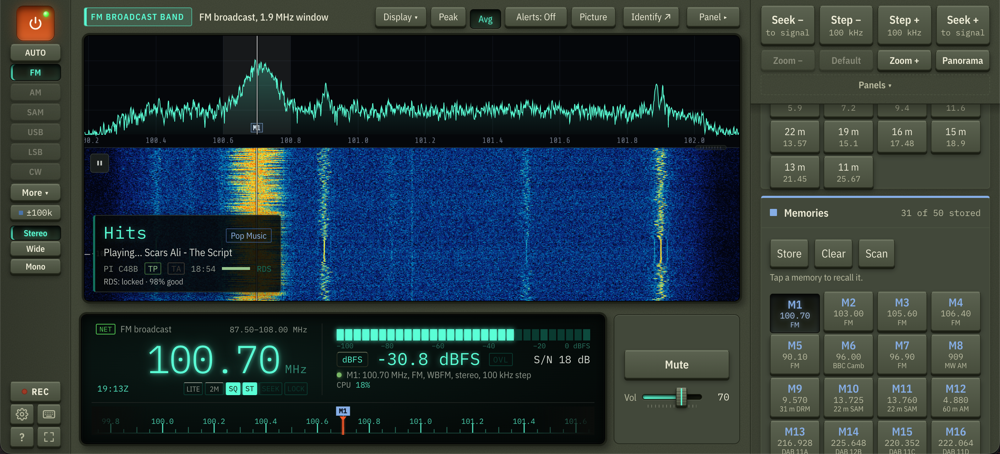
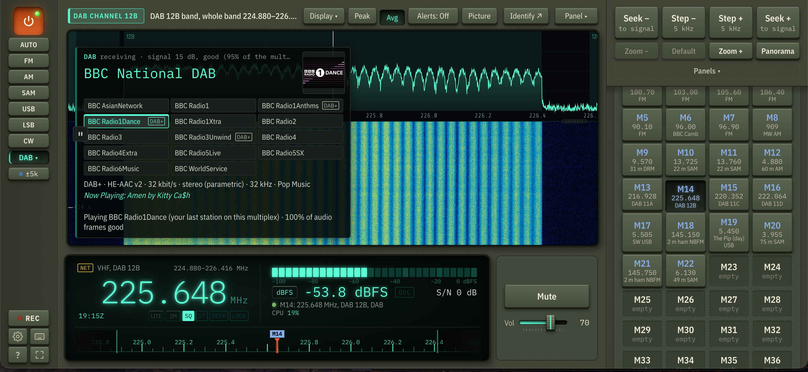

# OFFgrid-SDR

**A complete radio receiver in a single file. No installation, no internet, no account: plug in an RTL-SDR stick, open the page, and listen.**

OFFgrid-SDR is a software-defined radio receiver that runs entirely in your web browser from one file, `index.html`. With an RTL-SDR stick and an antenna it receives long, medium and short wave, FM, airband, VHF and UHF, and DAB and DRM digital radio, with dozens of decoders, on almost any computer. It can also use an SDRplay RSP across your network, through SDRplay's SDRconnect.



## What's new in 3.0

A complete redesign: OFFgrid-SDR now looks and works like a field radio.

- **A new console layout.** The spectrum and waterfall fill the middle of the window. The mode keys run down a rail on the left. The frequency sits under the screen like a radio's dial. The panels run the full height on the right, so more fits without scrolling.
- **A field-radio look.** An olive-drab case with keys that press in and stay in when on, an orange Power key with a green lamp, and sharper typefaces.
- **A tuning dial.** Drag it to tune, click a mark to go there. Your memories show along it as tags: click one to recall it.
- **Faders** for volume, squelch and gain.
- **A taller spectrum,** with a grip to share the height with the waterfall.
- **Laid out for Chromebooks** in laptop, tent and tablet modes, held either way up, and for short laptop windows.
- **DRM stations with more than one service:** choose between them, as All India Radio's stations carry two programmes and a news service.
- **More dependable device choice:** your chosen device (an RTL-SDR stick or SDRconnect) first, then the other, at every Power on, with a clear message when neither is there.
- **SDRconnect improvements:**
  - DAB cuts out far less.
  - Lite mode pauses by itself on DAB, DRM, AIS and VDL2.
  - The stick and the RSP each remember their own gain for each band.
  - Firefox and Safari can use SDRconnect.
- **New and fixed:**
  - CB Brazil (all 80 channels).
  - FM de-emphasis set from your location (75 µs in the Americas and South Korea).
  - No more FM stereo flickering on an empty channel.
  - Memories saved before 2.4 now show and recall the right band.
  - A decoder that hits an error restarts by itself.
- **The self-test** can run in a background tab.

The full list is in the app's help panel (**?**).

---

## Quick start

OFFgrid-SDR is **one file**, `index.html`. Everything else here is documentation and licences.

1. **Download `index.html`:** click it in the file list above, then **Download raw file**. (For everything, use **Code → Download ZIP**.)
2. **Open it** in Google Chrome or Microsoft Edge (or another Chromium-based browser).
3. **Plug in the stick,** press **Power on**, and choose the stick in the browser's window when it asks.

If no stick is plugged in, OFFgrid-SDR says so and tells you what to do. If you've also set up an SDRplay RSP (see below), it uses that instead.

**No stick yet?** Open `index.html?demo` for **demo mode**: simulated stations that show off every feature, including FM stereo with RDS, fading shortwave, SSB and Morse, weather fax, RTTY, NAVTEX, DSC, SSTV, PSK, FT8, FT4, WSPR, time stations, ACARS, APRS, AIS, Hellschreiber, a DAB multiplex, three DRM stations (one carrying two programmes and a news service), and the famous "Buzzer". Press **Power on**, then pick a station from the **Demo stations** list.

**Keeping up to date:** press **Check for updates** in the help panel (**?**). To update, put the new `index.html` in place of the old one. Your settings and memories are kept, though it's worth exporting a backup first (**Settings → Backup**).

### One-time driver setup

- **Windows:** run [Zadig](https://zadig.akeo.ie), choose *Options → List All Devices*, select *Bulk-In, Interface (Interface 0)* (or *RTL2838UHIDIR*), choose **WinUSB** and click **Replace Driver**.
- **macOS and Chromebooks:** nothing to set up.
- **Linux:** stop the TV driver from claiming the stick, and give your user access to it:
  ```sh
  echo 'blacklist dvb_usb_rtl28xxu' | sudo tee /etc/modprobe.d/rtl-sdr-blacklist.conf
  sudo modprobe -r rtl2832_sdr dvb_usb_rtl28xxu        # or reboot
  echo 'SUBSYSTEM=="usb", ATTRS{idVendor}=="0bda", ATTRS{idProduct}=="2838", MODE="0666"' | sudo tee /etc/udev/rules.d/20-rtlsdr.rules
  sudo udevadm control --reload-rules && sudo udevadm trigger
  ```
  Then unplug the stick and plug it back in. With Snap Chromium on Ubuntu, also run `sudo snap connect chromium:raw-usb`.

Only one program can use the stick at a time, so close SDR#, SDR++, gqrx or rtl_tcp first.

---

## Using an SDRplay RSP (through SDRconnect)

OFFgrid-SDR works with an **RTL-SDR stick** by default, but it can also use an **SDRplay RSP** through SDRplay's **SDRconnect**, on the same computer or another on your network (a Raspberry Pi in the shed, say). This also works in **Firefox and Safari**, which can't use a USB stick.

**Setting up:** SDRconnect must already be running on the RSP's computer, with its WebSocket API on port 5454. Then, in OFFgrid-SDR, choose **SDRconnect** in *Settings → Device*, enter its address, press **Test**, then **Power on**.

**Your chosen device first, then the other one.** At every Power on, the device chosen in *Settings → Device* is tried first, and the other is tried only if it isn't there:
- **With the stick chosen,** the browser's stick window opens first. Close it without choosing a stick, and SDRconnect is tried.
- **With SDRconnect chosen,** it has a couple of seconds to answer, then the stick is used.

The other device stands in only until Power off; your choice never changes by itself.

**Each device remembers its own RF gain for each band.** The gain means dB on a stick but the RSP's LNA steps through SDRconnect, so each keeps its own.

**RSP models:**
- **RSP1A and RSP1B** need nothing more.
- **The RSPdx** switches antennas by frequency (A from 30 MHz up, B below, by default; Antenna C works up to 200 MHz).
- **The RSPduo** uses its first tuner.

**The network:**
- **Test** checks that SDRconnect answers, lists the RSP's antenna ports, and measures whether your network **keeps up**, **only just** keeps up, or is **too slow** for the full stream.
- **The full stream at 2 MHz needs about 8.2 MB/s** (66 Mbit/s), continuously. **DAB needs it without a break**, so a cable at both ends is best. On Wi-Fi, a brief stall can make SDRconnect drop a little data, which DAB hears as a split-second cut. OFFgrid-SDR keeps a half-second reserve on DAB to ride out the network's ups and downs.
- **Lite mode** (the **LITE** key under the frequency, or *Settings → Device*) is for a slow network. SDRconnect sends its own sound and spectrum, about **0.2 MB/s**. The speaker, the audio decoders, the spectrum, the waterfall and the Signal Monitor's measurements all carry on. **DAB, DRM, AIS and VDL2** need the full stream: choosing one of them pauses Lite mode, and leaving it brings Lite mode back.
- **Wide views** of 6, 8 and 10 MHz come straight from the RSP, using the **span key** beside LITE. In full mode they need 24, 32 and 40 MB/s (wired gigabit for 10 MHz). DAB always uses 2 MHz, so the span key is greyed out on DAB.

**A Raspberry Pi as the SDRconnect server** works well. Use **Raspberry Pi OS Lite**, especially on a 1 GB Pi, since with a desktop it runs short of memory.

**The full guide, [SDRconnect.md](SDRconnect.md),** covers installing SDRconnect, running the headless server as a service that starts at boot (with a Raspberry Pi example), the firewall, the RSP models, how the RSP's two gains are handled, and troubleshooting.

---

## Decoders

- **DAB and DAB+:** the multiplex's name and stations to pick from, with the sound of either kind (DAB+ in HE-AAC, DAB in MP2, at any bit rate). For each station it shows the format, bit rate, programme type, "now playing" text, and logo or SlideShow pictures where the multiplex sends them. Your last station on each multiplex is remembered.
- **DRM** digital radio, on long, medium and short wave:
  - sound in AAC and xHE-AAC;
  - the station's name, language, text message, SlideShow pictures and **Journaline** news pages;
  - **a choice between a station's services**, as All India Radio's stations carry: up to four, such as two programmes and a news service, remembered for each station.
- **RDS** on FM: station name, programme type (RBDS types in the Americas), RadioText and clock.
- **Morse (CW)**, 4 to 60 words per minute, and **RTTY**, each finding the speed, shift and mark/space by itself.
- **NAVTEX** maritime safety messages, and **DSC** ships' calls (distress in red).
- **FT8 and FT4,** with each station's country, distance and bearing, CQ filtering and sorting, and **deeper decoding** that finds weaker stations hidden under strong ones.
- **WSPR** beacons down to about −28 dB, correcting a clock a minute or so out.
- **Time signals** from CHU, WWV, WWVH or RWM, with **Find a time station** and **Clock details**. **Heard** and **Band survey** show who you can hear and which bands are open.
- **APRS** positions, weather and messages, and **AIS** ships on both channels at once, each with distance and bearing.
- **VDL2** aircraft datalink, every channel in view at once, with ACARS messages in full and each aircraft's country.
- **ACARS** aircraft messages.
- **SSTV** pictures (Martin, Scottie, PD).
- **PSK31/63/125** and **Hellschreiber**.
- **Weather fax** charts, saved as PNG.

**DAB+**, with the multiplex's stations to choose from:



**DRM**, with a station's services to choose from:


---

## Known limitations

- **Browsers:** a USB stick needs WebUSB, which only Chromium-based browsers have (Chrome, Edge, Opera and so on). Firefox and Safari can run demo mode, or use an SDRplay RSP through SDRconnect.
- **One program at a time** can use the stick.
- **Tuners:** R820T, R820T2 and R828D sticks only. Older E4000, FC0012, FC0013 and FC2580 sticks won't work.
- **SDRplay RSPs (through SDRconnect):**
  - **SDRconnect must be running** on the RSP's computer, with its WebSocket API on (port 5454).
  - **No bias-tee control:** SDRconnect's API (version 1.0.3) has none. Switch it on in SDRconnect, or in an SDRconnect profile that OFFgrid-SDR applies when connecting.
  - **The RSPduo** uses its first tuner only.
  - **Open OFFgrid-SDR from a file or an `http://` address:** a page served over `https://` can't connect to SDRconnect.
  - **Retuning goes over the network,** so Seek, Scan and the band survey are slower than with a stick.
  - **DAB on Wi-Fi** can still cut out for a split second now and then, when SDRconnect drops data during a network stall. A cable at both ends is the cure.
  - **SDRconnect 1.0.6 or later** is needed (1.0.10 still reports its API as 1.0.3).
- **DRM** needs a good signal: about 10 dB for 16-QAM and 16 dB for 64-QAM. Below that, the settings are read but not the name or sound. The few stations using unequal protection or hierarchical modulation aren't decoded yet. **DRM+ (DRM in the FM band) isn't supported yet.**
- **DAB** needs a good signal: about 8 dB for the sound, while the station list comes through down to about 3 dB. An outdoor or loft aerial helps a great deal. Logos and pictures appear only where the multiplex broadcasts them, and other DAB data services aren't shown.
- **RTL-SDR Blog V4 near 28.8 MHz:** the stick's own 28.8 MHz clock shows as a spike there. On **10 m**, the trial setting *Settings → Device → RTL-SDR Blog V4 on 10 m* tunes the stick just above it, leaving out most of the spike.
- **The Signal Monitor** watches only what's in the radio's present view (2 MHz with a stick, up to 10 MHz with an RSP). Its clips are kept in memory and lost when the page closes, so save the ones you want to keep.
- **Waterfall replay** uses memory (about 123 MB for 30 seconds), so it's off by default.
- **AUTO** judges a couple of seconds of signal, so it can be wrong on very weak signals: choose the mode yourself if something sounds wrong.
- **FT8 and FT4** reach slightly less deep than WSJT-X on a single weak station.
- **Time signals:** MSF and DCF77 are below the sticks' range, and a web page can't set the computer's own clock (**Clock details** shows how).
- **Weather fax:** the US National Weather Service has proposed closing its HF radiofax stations towards the end of 2026. They're marked in the station list.
- **Smaller points:**
  - Morse may miss the first letter while locking on.
  - The sound runs about 0.2 s behind the waterfall, and Bluetooth adds more.
  - Reception is weaker below about 500 kHz.
  - With a stick, Panorama looks at one slice at a time.
  - On direct-sampling sticks, the RF gain has no effect on shortwave.
- **Background tabs:** OFFgrid-SDR keeps playing in a background tab, but if Chrome's Memory Saver puts the tab to sleep, everything stops. Add OFFgrid-SDR to *Always keep these sites active*.
- **Audio extensions** need *Allow access to file URLs* (in `chrome://extensions`) when OFFgrid-SDR is opened as a file.
- **Slower computers:** use **Low-power mode**; a very old or cheap machine may still struggle.

---

<p>
  
  visits and counting!
</p>

## Support

OFFgrid-SDR is free. If it's useful to you, you can [**buy me a coffee**](https://buymeacoffee.com/billynomates1974). ☕

---

## Thanks and credits

**Thanks** to everyone who has tested OFFgrid-SDR and reported problems, especially:
- **Venkatesh** in India, whose report led to choosing between a DRM station's services;
- the Brazilian user who pointed out Brazil's 80-channel CB band.

OFFgrid-SDR is built on the work of others:

- [**@jtarrio/webrtlsdr**](https://github.com/jtarrio/webrtlsdr) by Jacobo Tarrío: the WebUSB driver for the RTL2832U and its tuners, including the RTL-SDR Blog V4's HF upconverter. Apache License 2.0. Several of OFFgrid-SDR's fixes to it have since been taken into the original: many thanks to Jacobo for his help.
- [**@jtarrio/signals**](https://github.com/jtarrio/signals) by Jacobo Tarrío: the signal processing, including the FFT, filters, and the FM, AM, SAM, SSB and CW demodulators. Apache License 2.0.
- **Google Radio Receiver**, the original Chrome app these libraries grew from.
- [**Osmocom rtl-sdr**](https://osmocom.org/projects/rtl-sdr), for working out how to use these USB TV sticks as software-defined radios.
- [**RTL-SDR Blog**](https://www.rtl-sdr.com), for the V4 hardware and their open-source driver work.
- [**FAAD2**](https://github.com/knik0/faad2) by M. Bakker, Nero AG, Ahead Software AG and contributors: the AAC decoder that plays DRM's and DAB+'s sound, built in with its DRM support and one small change so that it also decodes DAB+. GPL 2 or later. Its exact source, the change and the build script are in the `licenses/faad2` folder.
- [**libxaac**](https://github.com/ittiam-systems/libxaac) by Ittiam Systems, part of the Android Open Source Project: the xHE-AAC decoder for DRM, built in unmodified with OFFgrid-SDR's small wrapper. Apache License 2.0. Its exact source and build script are in the `licenses/libxaac` folder.
- [**pl_mpeg**](https://github.com/phoboslab/pl_mpeg) by Dominic Szablewski, whose MP2 decoder (based on kjmp2 by Martin J. Fiedler) plays the original DAB's sound, with three small changes for DAB. MIT License. Its modified source, the changes and the build script are in the `licenses/pl_mpeg` folder.
- [**welle.io**](https://github.com/AlbrechtL/welle.io) by Albrecht Lohofener and contributors: OFFgrid-SDR's DAB receiver uses its tables, from the DAB standard (ETSI EN 300 401), and follows its methods. GPL 2 or later.
- [**Dream**](https://github.com/Drm-tools/dream), the open-source DRM receiver by Volker Fischer (Technische Universität Darmstadt) and contributors: OFFgrid-SDR's DRM receiver uses Dream's tables and follows its methods, from the DRM standard (ETSI ES 201 980). GPL 2 or later.
- **Fraunhofer IIS**'s reference Journaline decoder (in Dream's source, GPL 2 or later), which OFFgrid-SDR's own Journaline decoder follows.
- The demo's DRM jingle is an original tune written for OFFgrid-SDR, encoded once with [**FAAC**](https://github.com/knik0/faac)'s DRM encoder, its xHE-AAC and DAB+ versions with libxaac's encoder, and its MP2 version with [FFmpeg](https://ffmpeg.org). None of these encoders is in OFFgrid-SDR: only what they made.
- [**ft8_lib**](https://github.com/kgoba/ft8_lib) by Kārlis Goba: the FT8 and FT4 tables, error correction, message formats and decoding method that OFFgrid-SDR's decoders follow. MIT License. FT8 and FT4 were created by **Joe Taylor, K1JT**, and **Steve Franke, K9AN** ([WSJT-X](https://wsjt.sourceforge.io)), and taking decoded stations out of the signal to find weaker ones follows WSJT-X's method.
- **WSPR** was created by **Joe Taylor, K1JT**. OFFgrid-SDR's WSPR decoder follows the published protocol, checked against the encoder in [**WsprryPi**](https://github.com/JamesP6000/WsprryPi).
- [**acarsdec**](https://github.com/TLeconte/acarsdec) by Thierry Leconte, whose method of demodulating ACARS OFFgrid-SDR's own decoder follows.
- [**dumpvdl2**](https://github.com/szpajder/dumpvdl2) by Tomasz Lemiech, and its [**libacars**](https://github.com/szpajder/libacars): OFFgrid-SDR's own VDL2 decoder follows the VDL Mode 2 standard, with dumpvdl2 as the reference it was checked against on a real recording. No dumpvdl2 code is used.
- **SDRplay**'s published *SDRconnect WebSocket API* specification, which OFFgrid-SDR's network input follows. No SDRplay code is used.
- **APRS** was created by **Bob Bruninga, WB4APR**. OFFgrid-SDR's APRS decoder follows the published AX.25 and APRS specifications, and the Mic-E format published by **TAPR**.
- **AIS** follows the ITU's published standard (ITU-R M.1371), checked against the examples in Eric S. Raymond's [**AIVDM/AIVDO protocol decoding**](https://gpsd.gitlab.io/gpsd/AIVDM.html) guide for gpsd.
- **PSK31** and its Varicode alphabet were created by **Peter Martinez, G3PLX**.
- The time-code formats are published by the **National Research Council Canada** (CHU) and **NIST** (WWV and WWVH). The WWV bit layout follows the [**NTP project**](https://www.ntp.org)'s WWV driver.
- Aircraft countries follow **ICAO's allocation of 24-bit aircraft addresses**, as listed by [**tar1090**](https://github.com/wiedehopf/tar1090). Callsign countries follow the **ITU's allocation of callsign prefixes**. Both tables are built in, so they work offline.
- [**lamejs**](https://github.com/zhuker/lamejs), the JavaScript port of the LAME MP3 encoder. LGPL.
- [**RNNoise**](https://github.com/xiph/rnnoise) by Jean-Marc Valin (Mozilla and the Xiph.Org Foundation), the neural network behind the AI voice cleaner (BSD licence), in the WebAssembly build [**@jitsi/rnnoise-wasm**](https://github.com/jitsi/rnnoise-wasm) by Jitsi (Apache License 2.0).
- Fonts, all under the SIL Open Font License:
  - [**IBM Plex Sans Condensed** and **IBM Plex Mono**](https://github.com/IBM/plex), designed by Mike Abbink with Bold Monday for IBM, packaged by [Fontsource](https://fontsource.org): the typefaces of the 3.0 design;
  - [**Barlow Semi Condensed**](https://github.com/jpt/barlow) and [**Share Tech Mono**](https://fonts.google.com/specimen/Share+Tech+Mono).
- [**esbuild**](https://esbuild.github.io), which bundles everything into a single file that runs offline.
- [**Zadig**](https://zadig.akeo.ie) by Pete Batard, for installing the WinUSB driver on Windows.
- [**Shortwave.Live**](https://shortwave.live), the schedule database the Identify menu's "Shortwave radio schedule" opens.
- Frequencies for the Mystery stations come from [**Priyom**](https://priyom.org).

**OFFgrid-SDR is free software**, under the [GNU General Public License, version 3](https://www.gnu.org/licenses/gpl-3.0.html) or (at your option) any later version: you may use, share and change it, and changed versions you share must stay under the same licence. See the `LICENSE` file. The licence texts for the parts it includes are in the `licenses` folder, along with the source and build scripts of the decoders built into it in compiled form, which the GPL asks to accompany them.
